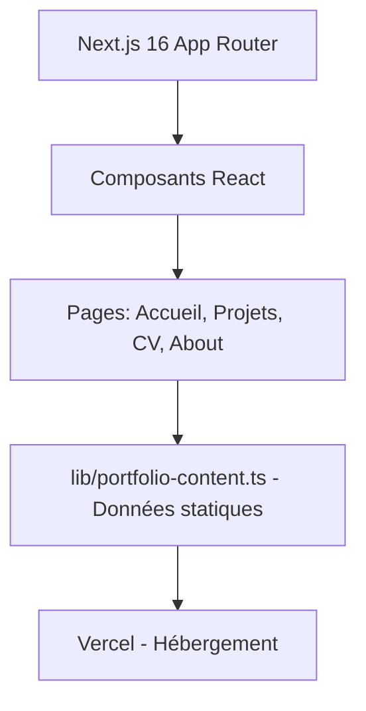
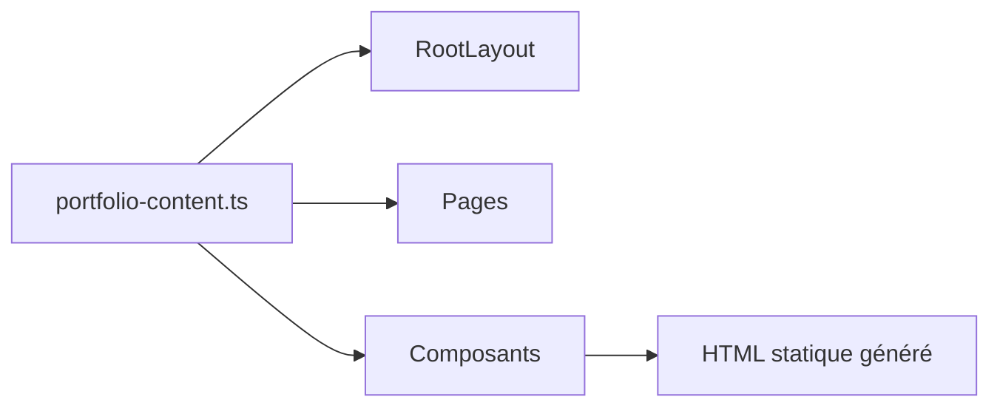
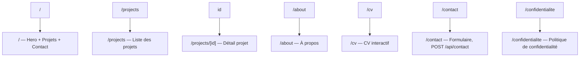

# Architecture — Portfolio v2

## Vue d'Ensemble

## Composants
### Frontend
- **Framework** : Next.js 16 (App Router)
- **UI Library** : Tailwind CSS 4 + motion (animations)
- **State Management** : Aucun (données statiques depuis `lib/portfolio-content.ts`)
- **Rendering** : SSG (Static Site Generation) via Next.js
- **3D/WebGL** : OGL (OpenGL abstractions légères)

### Backend
- **API** : `app/api/contact/route.ts` (POST) reçoit le formulaire de `/contact`,
  vérifie les champs (`lib/contact.ts`), écarte les robots (champ piège `website`),
  limite à 5 messages par IP et par 10 minutes (`lib/rate-limit.ts`, en mémoire, donc
  par instance), puis envoie l'email par l'API REST de Resend. La clé `RESEND_API_KEY`
  et l'adresse `CONTACT_TO_EMAIL` sont des variables d'environnement Vercel, jamais
  envoyées au navigateur (voir `.env.example`). Rien n'est stocké en base.
- **Admin retiré** : la page `/admin` et la route `/api/admin` vérifiaient le mot de
  passe dans le navigateur (donc lisible dans le JS publié) et ne sauvegardaient rien.
  Le CV se configure dans `lib/portfolio-content.ts` (`cv`).
- **En-têtes de sécurité** : CSP et autres en-têtes dans `next.config.ts` (`headers()`)

### Base de Données
- **Type** : Aucune base de données — tout est statique
- **Contenu** : Données dans `lib/portfolio-content.ts` (projets, expérience, stack, etc.)

## Flux de Données

## Décisions Techniques
| Décision | Justification | Alternatives Rejetées |
|----------|---------------|-----------------------|
| Next.js 16 (pas statique pur) | SSR pour SEO, App Router pour performance | Nuxt (moins adapté pour portfolio simple), Gatsby (déprécié) |
| Données statiques dans un fichier TS | Pas besoin de CMS, déploiement simple, zéro latence | Strapi (overkill), Markdown/MDX (complexité inutile pour ce volume) |
| OGL plutôt que Three.js vanilla | Plus léger, optimisé pour le web, meilleure DX | Three.js vanilla (plus lourd), R3F (overkill) |
| Vercel pour l'hébergement | Natif Next.js, déploiement automatique, GitHub Student | GitHub Pages (incompatible avec SSR/API routes) |

## Invariants
- Toutes les données sont dans `lib/portfolio-content.ts` — pas de fetch externe
- Le site doit fonctionner sans JavaScript (graceful degradation)
- Les pages légales sont accessibles depuis le footer

## Dépendances Externes
| Service | Usage | Lien |
|---------|-------|------|
| Vercel | Hébergement | `https://vercel.com` |
| Vercel Web Analytics | Mesure d'audience sans cookie (`<Analytics />` dans `app/layout.tsx`, à activer dans l'onglet Analytics du projet) | `https://vercel.com/docs/analytics` |
| Resend | Envoi des emails du formulaire de contact (domaine `scapeternam.dev` vérifié) | `https://resend.com` |
| Name.com | Domaine `scapeternam.dev` (DNS, dont les enregistrements Resend) | `https://name.com` |

## Schéma des Routes

## Sécurité
- **CSP** : en-têtes posés dans `next.config.ts`
- **Rate Limiting** : sur `/api/contact`, en mémoire par instance (frein, pas garantie)
- **Secrets** : Aucun stocké dans le code
- **HTTPS** : Géré par Vercel
